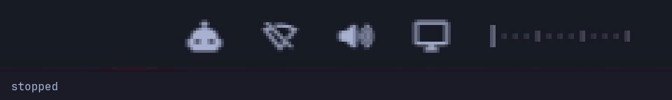
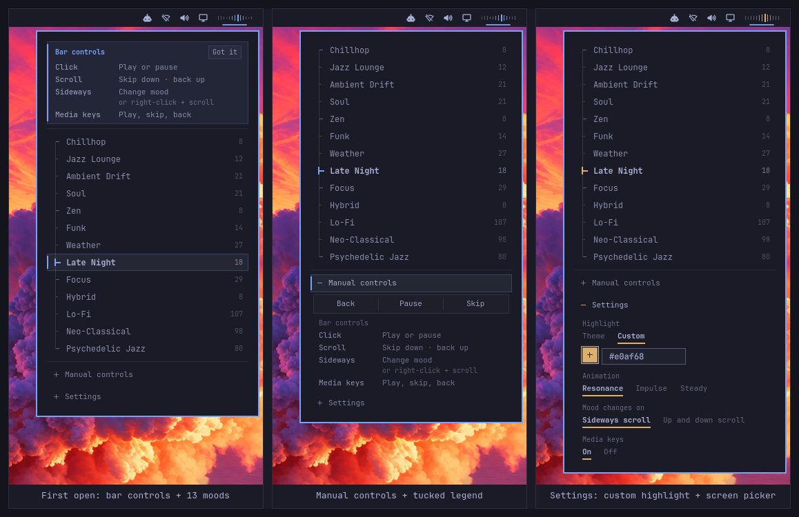
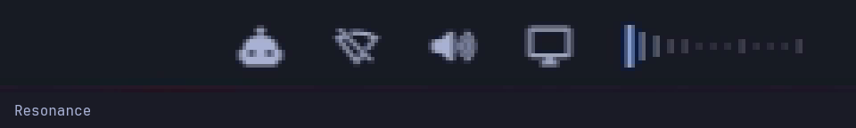

**mood** — music beneath your work.

```text
█▄ ▄█ ▄▀▀▄ ▄▀▀▄ █▀▀▄
█ ▀ █ █  █ █  █ █  █
▀   ▀  ▀▀   ▀▀  ▀▀▀
```

# mood

[](manifest.json)
[](LICENSE)


[](catalog/categories.json)


A quiet music plugin for [Omarchy](https://omarchy.org). Pick a mood, press
play, and get back to what you're doing. One small comb in your bar shows the
mood and whether music is playing — and it's also the control. No song titles,
album art, or queue clutter.

It streams 451 CC0 tracks one at a time on demand from
[Open Lo-Fi](https://github.com/btahir/open-lofi) and
[Alec Penn Radio](https://archive.org/search?query=creator%3A%22Alec+Penn+Radio%22).
Nothing gets downloaded in bulk, nothing is saved to disk, and nothing plays
until you ask.

> Experimental, checked on Omarchy 4.5.0. A full listening pass across all 451
> tracks is still ahead.



Right-click the bar item for all 13 moods, manual controls, and settings —
including picking a custom highlight color straight off your screen:



Three motion styles follow the plugin's own audio (never system sound):
**Resonance**, **Impulse**, or **Steady** (`0%` shell CPU):



## Install

Uses `mpv`, `python`, `ffmpeg`, and `hyprpicker` — all already in a default
Omarchy install.

```sh
omarchy plugin add https://github.com/0xBreadguy/mood --enable
```

Update or remove it anytime:

```sh
omarchy plugin update 0xbreadguy.mood && omarchy restart shell
```

```sh
omarchy plugin remove 0xbreadguy.mood    # stops playback and removes the widget
rm -r ~/.local/state/mood                # clears saved last mood and guide state
```

Cloning or pulling this repo installs nothing by itself.

## Controls

| | |
| --- | --- |
| Click | Play or pause |
| Scroll down / up | Skip, or go back to the track you last heard |
| Scroll sideways | Next or previous mood (or hold right-click + scroll) |
| Right-click | Open the mood popup and settings |
| Media keys | Play/pause, skip, and back |

Swap vertical and sideways scroll in Settings, or drive the plugin from a
script or keybind (`omarchy-shell mood toggle | skip | back | step 1 | set late-night | popup | status`).

## Go deeper

- [Playback & sources](docs/playback.md) — on-demand CC0 streaming, audio
  analysis, and resource costs.
- [Surfaces](docs/surfaces.md) — how the bar visual works and how to build a
  look of your own.
- [Contributing](CONTRIBUTING.md) — local dev symlink, catalog updates, and
  tests (`node --test test/`, `python3 -m unittest discover -s test`,
  `tools/box-check.sh`).

Omarchy only. [MIT](LICENSE) for the plugin code; streamed tracks keep their
upstream CC0 licenses, and no music files are bundled here. The name is the
premise — it's written lowercase.
